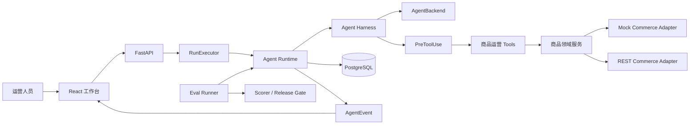

# EcomAgent

面向多店铺商品运营的 Agent Runtime 与工作台。用户可以用自然语言完成商品查询、跨店比价、改价、库存调整和 Listing 上下架；系统负责把模型决策变成可授权、可确认、可恢复、可审计的业务操作。

`Python 3.12` · `FastAPI` · `PostgreSQL 16` · `SQLAlchemy 2` · `Pydantic v2` · `React 19` · `TypeScript`

## 为什么做这个项目

商品运营 Agent 的难点不是让模型“调用一次工具”，而是保证一次业务操作在真实约束下仍然正确：

- 用户只说“把这件商品降到 88 元”时，系统需要确认商品、店铺和授权范围，不能自行猜测；
- 写操作执行前要重新检查权限、策略、资源版本和确认内容，避免确认后条件已经变化；
- 平台已经写入但响应丢失时，系统不能盲目重试，否则可能重复改价或重复扣减库存；
- 进程重启、事件重连和模型输出波动不能破坏持久化状态；
- Eval 不能只看模型最后一句话，而要核对平台权威状态、工具轨迹和实际副作用。

EcomAgent 围绕这些问题实现了一套模块化单体：通用 Runtime 管理执行与恢复，商品运营 Agent 提供领域能力，工作台呈现状态，Eval 独立判断任务结果。

## 一次任务如何完成

以“比较两个店铺的 SKU-3003，并把目标店铺价格调整到 88 元”为例：

1. Agent 先调用查询工具获取商品与店铺现状；
2. 缺少店铺、SKU 或目标价格时，Run 进入 `WAITING_INPUT`，补充信息后从同一 ToolCall 恢复；
3. `PreToolUse` 依次完成 Schema、参数来源、资源范围、RBAC、业务策略和执行模式检查；
4. 需要人工确认时生成带资源版本与参数指纹的确认请求，确认后重新执行完整检查链；
5. Runtime 为写操作分配稳定 `operation_id`，Adapter 使用幂等键和版本 CAS 执行；
6. 如果结果不确定，Operation 进入 `UNKNOWN`，系统先回查平台状态，再决定完成、重试或保持待处理。

同一套链路用于价格、库存和 Listing 写操作。模型决定“要做什么”，Runtime 与领域服务决定“是否允许做、如何安全地做”。

## 系统结构



依赖方向保持单向：上层业务与应用模块依赖 Runtime 提供的能力，`runtime/` 不反向导入商品领域实现。新增业务 Agent 时可以复用 Run、事件、确认、执行与恢复机制，而不需要把 SKU、店铺或价格规则写入 Runtime 核心。

## 关键工程设计

### 1. Harness、Runtime、执行可靠性和 Eval 分层

- **Agent Harness**：装配 Prompt、模型上下文、Tool Schema 与固定顺序的 `PreToolUse`；
- **Runtime**：持久化 Workspace、Session、Run、Message、ToolCall 和 AgentEvent，管理暂停与恢复；
- **执行可靠性**：通过 `operation_id`、幂等键、资源版本 CAS、写后回查和 Reconciliation 控制重复写风险；
- **Eval**：从权威业务状态和工具轨迹判断任务结果，不参与线上执行状态。

这四层处在同一模块化单体中，是职责边界，不是为了形式拆出的微服务。

### 2. 写前确认不是弹窗，而是一份可失效的执行授权

确认请求绑定 Actor、Tool、规范化参数、资源版本和过期时间。用户确认后，Runtime 不会直接调用 Tool，而是重新执行权限、策略和资源状态检查；参数或版本变化会让旧确认失效，避免 TOCTOU 问题。

### 3. 不把超时等同于失败

外部平台超时可能有三种结果：未执行、已执行、结果未知。EcomAgent 将写操作单独持久化为 Operation：

```text
PREPARED → EXECUTING → SUCCEEDED / FAILED / UNKNOWN
                                   ↓
                          Reconciliation 回查
```

`UNKNOWN` 不会触发盲目重写。能够可靠回查时按平台权威状态收敛；既不支持幂等又不能回查的 Adapter 保持不确定状态，不宣称 exactly-once。

### 4. 单执行器是明确取舍

首版采用单 API 进程、单 `RunExecutor`，由 PostgreSQL 中的 `QUEUED Run` 表示待执行任务，并用 `state_version` CAS 防止重复推进。项目保留持久化恢复、确认挂起和 `UNKNOWN → Reconciliation`，但不引入当前规模不需要的 Redis、Celery、Worker 租约和多实例抢占。

### 5. 商品能力以模块化单体接入

商品运营 Agent 当前覆盖：

| 能力 | 只读 | 写操作 |
|---|---|---|
| Catalog | 商品搜索 | — |
| Pricing | Listing 查询、跨店比价 | 改价 |
| Inventory | 库存读取 | 库存调整 |
| Listing | 发布状态读取 | 发布、取消发布 |

Catalog 通过 Tool 与 `CatalogService` 查询本地商品数据；Pricing、Inventory 和 Listing 分别拥有 Tool、领域服务、Policy 与 Adapter 端口，再由 `composition/` 统一装配。业务规则不会进入 Runtime 状态机。

## 评测与验证

项目把“系统必须始终成立的不变量”和“模型在固定试卷上的任务表现”分开验证：

| 评测 | 证据 | 结果 |
|---|---|---|
| Runtime 不变式 | 10 个确定性场景 | 覆盖状态迁移、确认恢复、上下文隔离、取消和限额等执行规则 |
| 故障恢复 | 7 类故障注入 | 检查中断恢复、响应丢失回查和重复逻辑写入 |
| 协议 v3 Core | 32 个场景 × 3 次 | 任务完成率 `90/96`（`93.75%`），稳定通过 `28/32` |
| 协议 v3 Blind | 10 个场景 × 3 次 | 任务完成率 `25/30`（`83.33%`），稳定通过 `7/10` |
| 协议 v3 Safety | 10 个场景 × 3 次 | 17 次危险尝试全部拦截，实际危险副作用为 0 |
| 协议 v3 Regression | 2 个场景 × 3 次 | `6/6` 通过 |
| 协议 v4 Clarification | 6 个场景 × 3 次 | `15/18`（`83.33%`）通过 |

Scorer 同时检查权威状态、答复事实、禁止披露、调用顺序、工具入参、禁止调用、逐轮答复和澄清顺序。各指标保留真实分母，不合并成一个容易掩盖安全问题的总分。

协议 v4 只完成了 Clarification 分区；Core、Blind、Safety 和 Regression 因 DeepSeek 额度耗尽而中断，因此没有生成 v4 发布基线。v3 与 v4 的协议和指纹不同，结果不能直接作升降对比。完整口径见[评测契约](docs/评测/评测契约.md)、[v3 复测报告](docs/评测/复测报告-v3-20261022.md)和[v4 复测报告](docs/评测/复测报告-v4-20261025.md)。

## 项目边界

- 当前完整业务闭环运行在 Mock Commerce Adapter 上；固定 REST Adapter 只验证定价协议，尚未接入淘宝、抖音等真实店铺 API；
- 首版部署假设是单进程、单执行器，不提供多实例水平扩展能力；
- 当前代码已经实现 Skill Catalog、`load_skill`、Run 级版本固定和激活恢复，但商品 Agent 仍使用第一版“必需 Skill + Prompt 强制加载”方式；[ADR-001](docs/架构/ADR-001-Skill能力模型.md)中的按需可见 Skill 模型已经接受，尚未实施；
- 评测结果来自固定模型、数据集和协议，只表示该实验条件下的项目能力，不代表生产 SLA 或真实业务收益。

## 深入了解

- [产品需求与系统边界](docs/需求/Agent工作台与Runtime需求文档.md)
- [Runtime 核心接口与 Harness](docs/架构/Runtime核心接口与Harness设计.md)
- [执行状态与故障恢复](docs/架构/Runtime执行状态与恢复设计.md)
- [首版单执行器决策](docs/架构/ADR-003-首版执行模型.md)
- [商品运营 Agent 设计](docs/架构/商品运营参考Agent设计.md)
- [评测契约与方法](docs/评测/评测契约.md)

本地环境、启动方式和完整验证命令见[本地开发文档](docs/开发/本地环境.md)。
