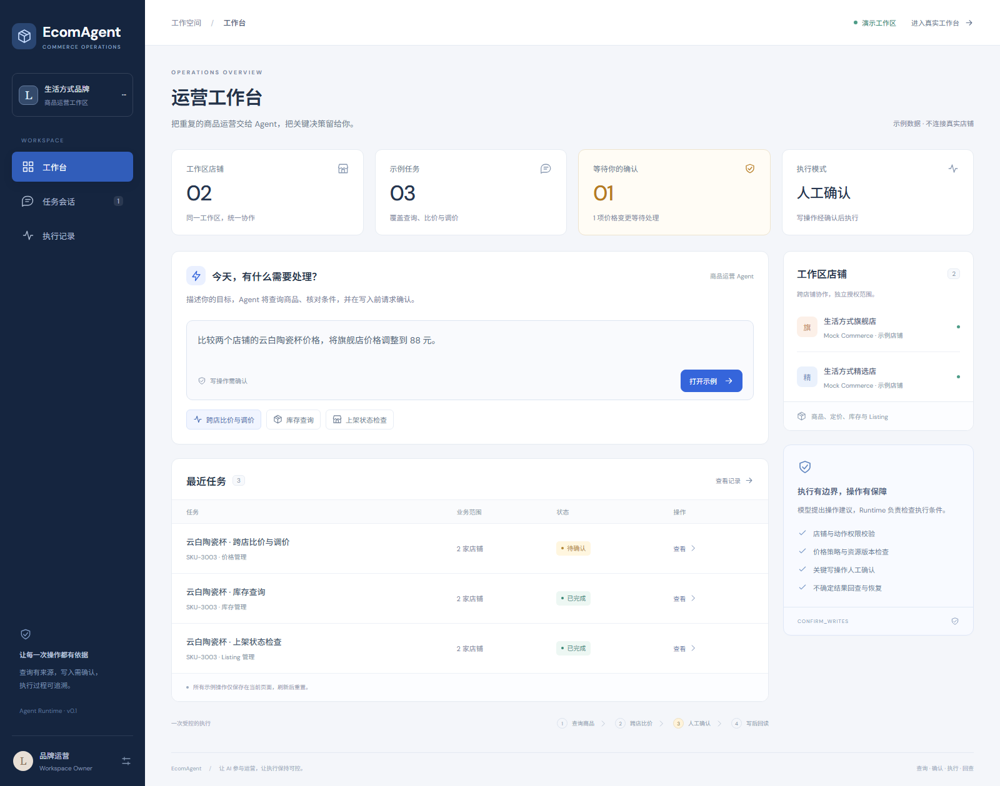
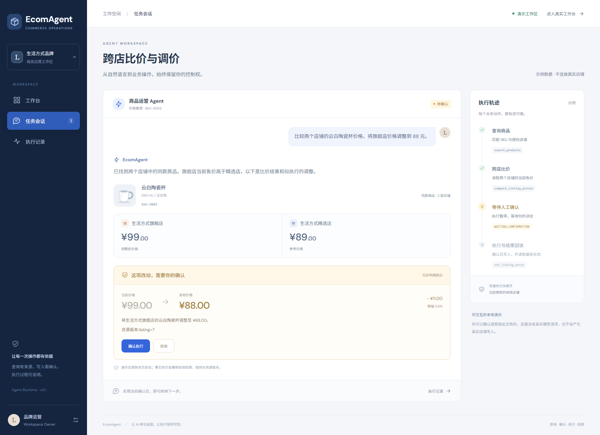
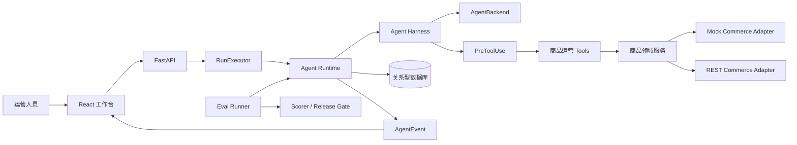

<div align="center">

# EcomAgent

**用自然语言管理商品，让每一次业务操作都有迹可循。**

面向电商商品运营的 Agent Runtime 与工作台，围绕工具调用安全、任务状态、写入可靠性与评测构建完整执行链路。


[工作台预览](#工作台预览) · [快速体验](#快速体验) · [系统结构](#系统结构) · [工程设计](#关键工程设计) · [评测方法](#评测与验证)

</div>

## 工作台预览

从商品查询、跨店比价，到改价、库存调整与 Listing 上下架，EcomAgent 将自然语言任务组织成可授权、可确认、可恢复、可审计的执行过程。

**运营概览** · 在一个工作区查看多店商品与任务，进入需要处理的运营场景。



**跨店比价与改价确认** · 对照店铺价格，查看调整内容与执行记录，在写入前完成确认。



> 截图来自内置演示模式，使用示例商品、店铺和任务数据。演示交互仅在前端模拟，不连接真实店铺，也不调用模型或执行后台写操作。实际 Runtime 的能力与验证结果见下文。

## 快速体验

仅预览工作台时，无需数据库、后端服务或 API Key：

```bash
cd apps/workbench
npm ci
npm run dev
```

打开 [http://localhost:5173/?demo=1](http://localhost:5173/?demo=1)，即可切换运营概览、跨店比价确认与执行记录。演示状态不会写入真实业务数据。

需要运行完整业务闭环时，请按[本地开发文档](docs/开发/本地环境.md)配置数据库、API 和模型连接，并从工作台正常登录入口进入。

## 为什么做这个项目

商品运营 Agent 的难点不是让模型“调用一次工具”，而是保证一次业务操作在真实约束下仍然正确：

- 用户只说“把这件商品降到 88 元”时，系统需要确认商品、店铺和授权范围，不能自行猜测；
- 写操作执行前要重新检查权限、策略、资源版本和确认内容，避免确认后条件已经变化；
- 平台已经写入但响应丢失时，系统不能盲目重试，否则可能重复改价或重复扣减库存；
- 进程重启、事件重连和模型输出波动不能破坏持久化状态；
- Eval 不能只看模型最后一句话，而要核对平台权威状态、工具轨迹和实际副作用。

EcomAgent 围绕这些问题实现了一套模块化单体：通用 Runtime 管理执行与恢复，商品运营 Agent 提供领域能力，工作台呈现状态，Eval 独立判断任务结果。

## 一次任务如何完成

以“比较两个店铺的 SKU-3003，并把目标店铺价格调整到 88 元”为例：

1. Agent 先调用查询工具获取商品与店铺现状；
2. 缺少店铺、SKU 或目标价格时，Run 进入 `WAITING_INPUT`，补充信息后从同一 ToolCall 恢复；
3. `PreToolUse` 依次完成 Schema、参数来源、资源范围、RBAC、业务策略和执行模式检查；
4. 需要人工确认时生成带资源版本与参数指纹的确认请求，确认后重新执行完整检查链；
5. Runtime 为写操作分配稳定 `operation_id`，Adapter 使用幂等键和版本 CAS 执行；
6. 如果结果不确定，Operation 进入 `UNKNOWN`，系统先回查平台状态，再决定完成、重试或保持待处理。

同一套链路用于价格、库存和 Listing 写操作。模型决定“要做什么”，Runtime 与领域服务决定“是否允许做、如何安全地做”。

## 系统结构

后端使用 Python、FastAPI、SQLAlchemy 与 Pydantic，工作台使用 React 与 TypeScript；任务状态、工具调用与操作记录持久化到关系型数据库。



依赖方向保持单向：上层业务与应用模块依赖 Runtime 提供的能力，`runtime/` 不反向导入商品领域实现。新增业务 Agent 时可以复用 Run、事件、确认、执行与恢复机制，而不需要把 SKU、店铺或价格规则写入 Runtime 核心。

## 关键工程设计

### 1. Agent Harness 与工具调用安全

针对模型参数错误、越权访问和高风险操作误执行，在 Harness 层建立 `PreToolUse` 校验链，依次检查参数、用户权限、店铺资源范围与业务规则。

写操作确认绑定目标资源、规范化参数和资源版本。确认后重新执行检查链，并通过 CAS 乐观锁校验资源版本，防止过期确认覆盖更新后的业务状态。

### 2. Agent Runtime 与任务状态管理

采用 **Workspace / Session / Run** 分层模型，分别管理品牌业务上下文、会话与单次任务执行。通过状态机管理任务生命周期，持久化关键执行步骤、工具调用结果和事件，支持任务暂停、补充信息、人工确认与中断恢复。

首版采用单进程、单执行器，以持久化任务队列与状态版本 CAS 防止重复推进，将业务能力与通用执行机制分离。

### 3. 工具执行可靠性与幂等控制

针对工具超时、任务重试和中断恢复可能导致的重复写入，为每笔业务操作分配稳定的 `operation_id`，结合幂等键、数据库唯一约束与事务处理控制重复执行风险。

外部平台超时不一定意味着写入失败。写操作独立持久化为 Operation，记录明确的执行状态：

```text
PREPARED → EXECUTING → SUCCEEDED / FAILED / UNKNOWN
                                   ↓
                          Reconciliation 回查
```

`UNKNOWN` 不会触发盲目重写。能够可靠回查时按平台权威状态收敛；既不支持幂等又不能回查的 Adapter 保持不确定状态，不宣称 exactly-once。

### 4. Agent Eval 与失败归因

围绕商品查询、跨店比价、确认后改价、库存调整与复合任务构建场景化评测。以业务最终状态判断任务是否完成，结合工具调用轨迹与安全约束定位失败原因，指导 Tool Schema、任务指令与交互流程的迭代。

评测独立于线上执行链路，将业务完成情况、安全拦截和故障恢复分别验证，具体方法见下文。

## 商品运营能力

商品运营 Agent 当前覆盖：

| 能力 | 只读 | 写操作 |
|---|---|---|
| Catalog | 商品搜索 | — |
| Pricing | Listing 查询、跨店比价 | 改价 |
| Inventory | 库存读取 | 库存调整 |
| Listing | 发布状态读取 | 发布、取消发布 |

Catalog 通过 Tool 与 `CatalogService` 查询本地商品数据；Pricing、Inventory 和 Listing 分别拥有 Tool、领域服务、Policy 与 Adapter 端口，再由 `composition/` 统一装配。业务规则不会进入 Runtime 状态机。

## 评测与验证

评测关注任务是否真正完成，以及执行过程是否满足安全约束。

| 验证方向 | 覆盖场景 | 判断依据 |
|---|---|---|
| 业务任务 | 商品查询、跨店比价、确认后改价、库存调整与复合任务 | 业务最终状态、目标资源与实际变更是否符合任务要求 |
| 工具调用安全 | 参数错误、越权访问、价格规则冲突与未确认写入 | 是否正确拦截违规调用，是否产生不允许的业务副作用 |
| 多轮交互 | 商品、店铺或目标值缺失，补充信息与人工确认 | 是否在信息完整、确认有效后继续执行 |
| 状态与恢复 | 任务中断、超时、响应丢失与重复请求 | 状态是否正确恢复，是否避免重复业务写入 |

失败分析结合工具入参、调用顺序、执行结果与最终答复，区分模型理解、工具选择、参数生成和执行链路问题。完整规则见[评测契约与方法](docs/评测/评测契约.md)。

## 项目边界

- 当前完整业务闭环运行在 Mock Commerce Adapter 上；固定 REST Adapter 只验证定价协议，尚未接入淘宝、抖音等真实店铺 API；
- 首版部署假设是单进程、单执行器，不提供多实例水平扩展能力；
- 当前代码已经实现 Skill Catalog、`load_skill`、Run 级版本固定和激活恢复，但商品 Agent 仍使用第一版“必需 Skill + Prompt 强制加载”方式；[ADR-001](docs/架构/ADR-001-Skill能力模型.md)中的按需可见 Skill 模型已经接受，尚未实施；
- 评测结果来自固定模型、数据集和协议，只表示该实验条件下的项目能力，不代表生产 SLA 或真实业务收益。

## 深入了解

- [产品需求与系统边界](docs/需求/Agent工作台与Runtime需求文档.md)
- [Runtime 核心接口与 Harness](docs/架构/Runtime核心接口与Harness设计.md)
- [执行状态与故障恢复](docs/架构/Runtime执行状态与恢复设计.md)
- [首版单执行器决策](docs/架构/ADR-003-首版执行模型.md)
- [商品运营 Agent 设计](docs/架构/商品运营参考Agent设计.md)
- [评测契约与方法](docs/评测/评测契约.md)

本地环境、启动方式和完整验证命令见[本地开发文档](docs/开发/本地环境.md)。
